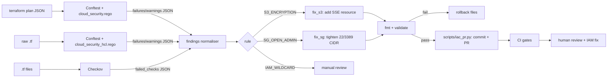

# IaC Mutation & Policy Remediation Report
**Project:** Autonomous Policy-as-Code Remediation & Dynamic IaC Mutation Engine
**Author:** Segun | **Run date:** 2026-11-19 to 2026-11-20
**Repo:** adeola2021/enterprise-devsecops-iac | **PR:** #15 (base: `iac-autofix-demo`)

## 1. Executive summary
A findings-driven pipeline detects three classes of cloud misconfiguration with OPA/Rego (Conftest) and Checkov,
rewrites the Terraform source to fix two of them, validates the result, rolls back on failure, and opens a
pull request. Wildcard IAM is detected but deliberately **not** auto-fixed; a human scoped it in a second commit.

| Stage | Conftest (plan JSON) | Checkov (blocking scope) |
|---|---|---|
| Before | 3 failures, 2 warnings | 3 failed (CKV_AWS_24, 25, 145) |
| After autofix | 0 failures, 2 IAM warnings | 4 passed, 0 failed |
| After human IAM commit | 0 failures, **0 warnings** | IAM checks 6 passed, 0 failed |

The autofix diff is 13 insertions and 2 deletions in one file. PR #15 passes all 4 CI checks.

### Execution environment (all real)
| Tool | Version |
|---|---|
| Terraform | 1.16.0 (real `init`, `validate`, `plan`, `show -json`; AWS provider v5.100.0) |
| OPA / Conftest | 1.19.0 / 0.69.0 |
| Checkov | 3.3.16 |
| Python / pytest | 3.10.12 / 9.1.1 |
| GitHub | Real PR #15, real Actions runs, authenticated with `gh` as `adeola2021` |

## 2. Architecture

**Contract between policy and fixer:** every Rego message begins `[RULE_ID] resource.address:`. The fixer parses that
prefix and maps Checkov `check_id`s to the same rule IDs. Findings from both tools are de-duplicated, so a resource
flagged by several sources is fixed once (extra sources show as `skipped`).

**Why text-level edits:** `hcl2` parses HCL into dicts but cannot write it back, which loses comments and formatting.
Surgical edits keep diffs reviewable. A string, comment and heredoc-aware brace matcher finds resource boundaries.

## 3. Rego policies
Two packages share the same message tags, so either scan path feeds the fixer.

| Package | Input | Used for |
|---|---|---|
| `cloud_security` (`policies/cloud_security.rego`) | `terraform show -json` plan | Main scan path, CI Gate 5, `demo.sh` |
| `cloud_security_hcl` (`policies/cloud_security_hcl.rego`) | Raw `.tf` parsed by Conftest | Fast pre-plan scan, no provider needed |

| Rule | Level | Logic | Checkov counterpart |
|---|---|---|---|
| S3 encryption | `deny` | Bucket needs a standalone SSE resource referencing it, or a legacy inline block | CKV_AWS_145 |
| SG hardening | `deny` | Ingress covering 22 or 3389 from `0.0.0.0/0` or `::/0`; 443 allowed | CKV_AWS_24, 25 |
| IAM least privilege | `warn` | Allow with `Action:"*"` and `Resource:"*"`; `warn` because the fix needs human judgement | CKV_AWS_63, 355 |

`opa check --strict` is clean. `opa test`: **11/11 pass** (4 plan-JSON tests and 7 raw-HCL tests, `evidence/` Section 8).

## 4. Mutation engine (`terraform_autofixer.py`)
- **S3:** inserts `aws_s3_bucket_server_side_encryption_configuration` after the bucket (KMS with `--kms-key-arn`). Idempotent.
- **Security groups:** rewrites `0.0.0.0/0` to `--admin-cidr` only inside ingress blocks that expose 22/3389/all-protocol.
- **IAM:** reported as `manual`, never edited.
- **Safety net:** `fmt`, then `validate`; on failure every changed file is restored and the exit code is 1.
- **Input hardening:** `--admin-cidr` must be a valid network and not `/0`; `--kms-key-arn` must match the KMS ARN grammar.
- **Dry run:** `--dry-run` prints a unified diff and writes nothing.
- **PR integration:** `scripts/generate_security_pr.py --mode iac` calls `scripts/iac_pr.py`. The default mode stays `appsec`, so the Phase 6 Semgrep behaviour is unchanged. The PR commit uses an explicit pathspec and refuses to run if the index has staged changes.

## 5. Evidence

### 5.1 Detection (before)
Raw HCL, `cloud_security_hcl` (`evidence/01_conftest_before.txt`):
WARN - [IAM_WILDCARD] aws_iam_role_policy.god_mode_heredoc: Allow Action:* on Resource:* ...
FAIL - [S3_ENCRYPTION] aws_s3_bucket.logs: S3 bucket has no server-side encryption configuration
FAIL - [SG_OPEN_ADMIN] aws_security_group.web: ingress 22-22 open to the internet
FAIL - [SG_OPEN_ADMIN] aws_security_group.web: ingress 3389-3389 open to the internet
Plan JSON, `cloud_security` (`evidence/01_conftest_plan_before.txt`): the same 3 failures plus **2** IAM warnings
(`god_mode` and `god_mode_heredoc`). Checkov (`evidence/01_checkov_before.txt`, `checkov_before.json`) reported
CKV_AWS_24, 25, 145, 63, 355, CKV2_AWS_40 and others.

### 5.2 Autofix (`evidence/02_autofix_run.txt`, `02_autofix.diff`)
[APPLIED] S3_ENCRYPTION aws_s3_bucket.logs checkov:CKV_AWS_145 added aws_s3_bucket_server_side_encryption_configuration (KMS)
[APPLIED] SG_OPEN_ADMIN aws_security_group.web checkov:CKV_AWS_24 restricted 2 admin ingress rule(s) to 10.0.0.0/8
[MANUAL ] IAM_WILDCARD aws_iam_role_policy.god_mode / god_mode_heredoc needs a human-authored least-privilege policy
The diff adds the SSE resource and changes the 22 and 3389 CIDRs to `10.0.0.0/8`. After the run, `grep -n "0.0.0.0/0"`
finds only line 56, the **port 443 rule, untouched**.

**Idempotence** (`evidence/03_autofix_idempotent.txt`): the second run prints no `[APPLIED]` lines, and
`git diff --stat` stays at 13 insertions and 2 deletions.

### 5.3 Validation and re-scan (after autofix)
- `terraform fmt -check` was silent and `terraform validate` printed `Success! The configuration is valid.`
- Conftest on a real plan (`evidence/05_conftest_after.txt`): `4 tests, 2 passed, 2 warnings, 0 failures`.
- Checkov blocking scope (`evidence/05_checkov_after.txt`): `Passed checks: 4, Failed checks: 0`.
- pytest: 10 passed (`evidence/04_pytest_after_rollback.txt` shows 12 after the rollback tests below).

### 5.4 Rollback tests (`tests/test_rollback.py`, 12 passed total)
- When `validate` fails, the file is restored byte-for-byte and the exit code is 1.
- When `validate` passes, the patch is kept and the 443 rule is untouched.

### 5.5 Pull request #15
- Base `iac-autofix-demo`; the diff touches exactly one file, `terraform/fixture/main.tf` (`evidence/06_pr_diff.txt`).
- Commit 1: the autofix. Commit 2 (`b536956`): a human replaced both IAM wildcards with `s3:GetObject` on the demo
  bucket's objects. After it: Conftest `4 passed, 0 warnings, 0 failures` (`evidence/07_conftest_final.txt`) and
  Checkov IAM checks `6 passed, 0 failed` (`evidence/07_checkov_iam_final.txt`).
- **First CI run** (`evidence/06_pr_checks_first_run.txt`, `06_legacy_pipeline_failure.log`): `gates` passed,
  `IaC Security Checks` failed. See Finding 4.
- **Final CI run** (`evidence/08_pr_checks_green.txt`, `08_pr_view_green.json`): **all 4 checks passed**:
  `gates`, `IaC Security Checks`, `Checkov` and `Semgrep OSS`.
- Screenshots: `evidence/screenshots/`.

## 6. Findings worth knowing
1. **A silent policy: 8/8 tests passed and 0 violations were reported.** Conftest wraps every HCL resource body in a one-element array (`"logs": [ {...} ]`), but the first rules and unit tests assumed an unwrapped object. The unit tests passed on hand-written input while real HCL never matched. Fix: a `body()` unwrapping helper, and unit tests built from the real `conftest parse` shape. **Lesson: always run the policy against real parsed input, not only unit-test fixtures.**
2. **`jsonencode` policies are invisible to raw-HCL Conftest.** Conftest sees them as the text `${jsonencode(...)}`. Only the plan-JSON path (and Checkov) catches `god_mode`. This is why the plan path is the main one.
3. **`CKV_AWS_19` does not fire on current Checkov; `CKV_AWS_145` (KMS) does.** An AES256 fix satisfies OPA but not CKV_AWS_145, so the pipeline needs `--kms-key-arn`. The demo ARN `.../key/REPLACE-ME` is a placeholder.
4. **A legacy pipeline failed on the fixture.** The Phase 4 workflow `iac-security-pipeline.yml` runs the Checkov action over all of `terraform/` with the full rule set and no soft-fail, so it failed on deliberately insecure fixture lines. The `Upload Checkov` SARIF error was a downstream symptom. Fix (`b3bea05`): `skip_path: terraform/fixture` on that one step. This is a documented exclusion of test data, not a weakened gate; the rest of `terraform/` is still scanned. `phase5_checkov_gate.sh` blocks only CKV_AWS_24 and 145, which the patched fixture passes.
5. **Autofix commit contained more than the fix.** A test run committed a staged file deletion along with the fixture. Fix: commit with an explicit pathspec, and refuse to run when anything is staged.
6. **Overlapping findings are normal.** One resource can be flagged by OPA and by two Checkov IDs; de-duplication shows as `skipped` rows in the PR table.
7. **`gh` limits.** This `gh` version has no `pr checks --watch` and no `pr diff --name-only`; plain `gh pr checks` exits non-zero while any check fails.

## 7. Limitations
- **Placeholders need real values:** the admin CIDR (`10.0.0.0/8`) and the KMS key ARN are human decisions; the PR body carries a reviewer checklist. The scoped IAM policy in the human commit is an illustrative example, not a real application requirement.
- Modules (`module.*`) are not handled; `dynamic "ingress"` and variable-held CIDRs are reported, not fixed; IPv6 `::/0` is detected but not rewritten.
- Raw-HCL Conftest cannot see `jsonencode` policies (Finding 2).
- Checkov check IDs drift across versions; the map was verified against 3.3.16 only.
- Only the three required classes are auto-fixed. Checkov also reports versioning, lifecycle, logging and public-access-block findings on the bucket, which are out of scope and risky to automate.
- **PR base:** PR #15 targets the baseline branch, never `main`, because the baseline fixture fails the gates by design. Do not merge the baseline into `main`.
- **CI token:** PRs created with the default `GITHUB_TOKEN` inside Actions do not trigger workflows. This PR was created from the workstation with `gh` auth, so it triggered normally; use a PAT or App token if the flow moves into Actions.
- **Phase 6 integration:** `--mode iac` is exercised end to end. `--mode all` (Semgrep, then IaC) and the Semgrep path were not re-run in this exercise; the default `appsec` mode is unchanged.
- `demo.sh` passes a syntax check (`bash -n`) and its paths point at `scripts/generate_security_pr.py`, but the full script was not re-run end to end after the path change. The evidence above came from the individual steps run by hand.

## 8. Reproduce
```bash
opa check policies/ --strict && opa test policies/ -v          # 11/11
python3 -m pytest -q                                            # 12 passed
conftest test plan.json -p policies -n cloud_security           # plan path
conftest test terraform/fixture -p policies --all-namespaces    # raw-HCL path
python3 scripts/generate_security_pr.py --mode iac --base iac-autofix-demo \
  --iac-findings evidence/conftest_before.json evidence/checkov_before.json \
  --kms-key-arn arn:aws:kms:us-east-1:111122223333:key/REPLACE-ME
```

## 9. Future work
A KMS key-creation fixer, `tflint`, module-aware remediation, and a `jsonencode`-aware raw-HCL rule.
