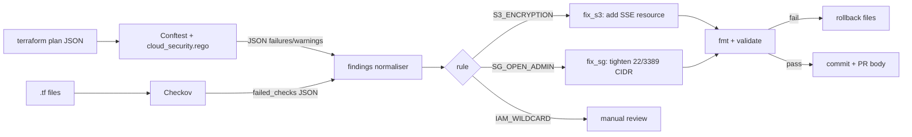

# IaC Mutation & Policy Remediation Report
**Project:** Autonomous Policy-as-Code Remediation & Dynamic IaC Mutation Engine
**Author:** Segun | **Run date:** 2026-11-18

## 1. Executive summary
A findings-driven pipeline now detects three classes of cloud misconfiguration with OPA/Rego and Checkov,
rewrites the Terraform source to fix two of them, validates the result, and prepares a pull request.
On the deliberately vulnerable fixture, **Conftest went from 3 failures to 0** and **Checkov's blocking scope
went from 3 failed checks to 4/4 passed**. The generated diff is 13 insertions / 2 deletions, touching only
security-relevant lines. Wildcard IAM is detected but deliberately **not** auto-fixed.

### Execution environment: what was real and what was not
| Item | Status |
|---|---|
| OPA 1.6.0 (`opa check --strict`, 4/4 Rego tests) | Ran for real |
| Conftest 0.62.0, Checkov 3.4.5 | Ran for real |
| Autofixer, 10 pytest tests, negative/rollback tests | Ran for real |
| `fmt` | Ran for real, using **OpenTofu 1.10.6** (`tofu fmt`; same formatter as `terraform fmt`) |
| `terraform init / validate / plan` | **Not run.** The sandbox blocks `releases.hashicorp.com` and the provider registry, so the AWS provider cannot be downloaded. |
| Conftest input | A **mock plan** (`tools/mock_plan.py`) built from the HCL, not a real `terraform show -json` |
| `terraform validate` substitute | `fmt` plus an `hcl2` **syntax** parse (`--validate-mode offline`). It does not check provider schema. |
| Pull request on GitHub, Actions run | **Not run.** There is no `gh` and no remote here. `--local-only` created the branch and commit and wrote the PR body. |

The code paths for the real runs exist (`--validate-mode full`, `PLAN_MODE=real ./demo.sh`, the workflow). Section 7 lists what to run on your workstation to close these gaps.

## 2. Architecture

**Contract between policy and fixer:** every Rego message begins `[RULE_ID] resource.address:`. The fixer parses that prefix, and maps Checkov `check_id`s to the same rule IDs. Findings from both tools are de-duplicated, so a bucket flagged by both is fixed once.

**Why text-level edits rather than parse-and-regenerate:** `hcl2` parses HCL into dicts but cannot write it back, which loses comments and formatting. Surgical edits keep diffs reviewable. A string, comment and heredoc-aware brace matcher locates resource boundaries, so `}` inside strings, comments and heredocs is not mistaken for a block end.

## 3. Rego policies (`policies/cloud_security.rego`)
| Rule | Level | Logic |
|---|---|---|
| S3 encryption | `deny` | Bucket must have a standalone `aws_s3_bucket_server_side_encryption_configuration` that **references it** (checked in `configuration`, since `bucket.id` is unknown at plan time), or a legacy inline block. |
| SG hardening | `deny` | Ingress on `aws_security_group` or `aws_security_group_rule` that includes 22 or 3389 (range- and `-1`-aware) from `0.0.0.0/0` or `::/0`. Port 443 is correctly allowed. |
| IAM least privilege | `warn` | Allow statement with `Action:"*"` **and** `Resource:"*"` (string or array form) in inline/managed policy resources. `warn` because remediation needs human judgement. |

`opa check --strict`: clean. `opa test`: **4/4 pass**.

## 4. Mutation engine (`terraform_autofixer.py`)
- **S3:** inserts an SSE resource after the bucket (KMS if `--kms-key-arn` is given, otherwise AES256). Idempotent.
- **Security groups:** rewrites `0.0.0.0/0` to `--admin-cidr` **only inside ingress blocks that expose 22/3389/all-protocol**. 443 is untouched.
- **IAM:** reported as `manual`.
- **Safety net:** `fmt`, then validation; on any failure all files are restored. Verified: after a forced validation failure the file hash was identical.
- **Input hardening** (added after a bug found during negative testing): `--admin-cidr` must parse as a network and may not be `/0`; `--kms-key-arn` must match the KMS ARN grammar, because both values are written into HCL. Per-finding scan errors are reported as `error` rather than crashing the run.
- **Dry run:** `--dry-run` prints a unified diff and writes nothing.

## 5. Evidence
Full output: `reports/transcript.txt`, `reports/negative_tests.txt`.

**Before (Conftest on the mock plan):**
```
WARN - [IAM_WILDCARD] aws_iam_role_policy.god_mode: Allow Action:* on Resource:* ...
FAIL - [S3_ENCRYPTION] aws_s3_bucket.logs: S3 bucket has no server-side encryption configuration
FAIL - [SG_OPEN_ADMIN] aws_security_group.web: ingress 22-22 open to the internet
FAIL - [SG_OPEN_ADMIN] aws_security_group.web: ingress 3389-3389 open to the internet
4 tests, 0 passed, 1 warning, 3 failures
```
**Before (Checkov):** `CKV_AWS_24` (SSH), `CKV_AWS_25` (RDP), `CKV_AWS_145` (S3 KMS) failed; plus advisory `CKV_AWS_63` and `CKV_AWS_355` (IAM).

**Autofix commit** (`fix(iac): remediate Checkov/OPA violations`, 13+/2−): adds `aws_s3_bucket_server_side_encryption_configuration.logs_sse`; changes the 22 and 3389 CIDRs to `10.0.0.0/8`.

**After:** Conftest `4 tests, 3 passed, 1 warning, 0 failures`; Checkov blocking scope `Passed checks: 4, Failed checks: 0`; `tofu fmt -check` clean; IAM still flagged for a human, as intended.

**Negative tests:** an injected KMS ARN is rejected; a `/0` admin CIDR is rejected; a failed validation triggers rollback with an identical file hash.

## 6. Findings worth knowing
1. **`CKV_AWS_19` passes on current Checkov.** S3 now encrypts all objects with SSE-S3 by default, so the unencrypted-bucket finding appears as **`CKV_AWS_145`, which demands KMS**. An AES256 fix satisfies the OPA rule but not `CKV_AWS_145`, so the pipeline needs a real `--kms-key-arn` to go fully green. The demo ARN (`.../key/REPLACE-ME`) is a placeholder and must be replaced.
2. **`terraform fmt -recursive` can reformat unrelated code.** The first run produced a stray whitespace change from a pre-existing misformatted line. The repo now commits an fmt-clean baseline, and the fixer keeps diffs minimal only if the repo is already fmt-clean.
3. **The guide's `pytest` command needs `pytest.ini` (`pythonpath = .`)** to import the fixer from `tests/`.
4. **Overlapping findings are normal.** One resource can be flagged by Checkov and OPA, and by two Checkov IDs. De-duplication shows as `skipped` rows in the PR table.

## 7. Limitations and remaining verification
- **Run on a workstation to complete the evidence:** `./demo.sh` (real `terraform plan`, `init`, `validate`), then push the PR branch and capture `gh pr checks`. The mock plan is a stand-in and could diverge from a real plan.
- Modules (`module.*`) are not handled; `dynamic "ingress"` and variable-held CIDRs are reported, not fixed; IPv6 `::/0` is detected but not rewritten.
- The replacement admin CIDR and the KMS key are human decisions; the PR template carries a reviewer checklist for both.
- Checkov check IDs drift across versions; the map in the fixer was verified against 3.4.5 only.
- **CI caveats:** PRs opened with `GITHUB_TOKEN` do not trigger workflows (use your own `gh auth`, a PAT, or an App token). `main` is red by design while the fixture is vulnerable.
- The Phase 6 Semgrep flow was not available, so `run_appsec()` in `generate_security_pr.py` is a documented hook, not an integration.
